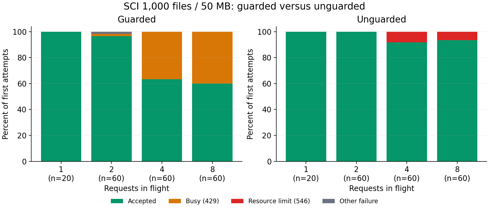

# Guarded versus unguarded verification on Supabase Edge

**Removing the guard improves first-attempt acceptance but causes real CPU and memory failures. Do not ship the unguarded buffered handler as-is.** All 60 unguarded requests at concurrency 2 passed. At concurrency 4 and 8, nine requests were lost when three shared workers exceeded their resource limits.

[Hosted run](https://github.com/azaho/sci/actions/runs/42169924541), measured commit `1245c42`. The same 20 synthetic 1,000-file, 50,000,000-byte publications and shuffled request schedules were used for both modes in `us-east-1`. Each mode received 200 first attempts, with no retries. The generated handlers differ by exactly the guard line; activity instrumentation is identical. [Protocol](../../README.md), [full verifier coverage](../../../full/COVERAGE.md).

## Outcomes

| Requests in flight | Guarded: accepted | Guarded: busy | Guarded: other | Unguarded: accepted | Unguarded: resource limit |
| --- | ---: | ---: | ---: | ---: | ---: |
| 1 | 20/20 | 0 | 0 | 20/20 | 0 |
| 2 | 58/60 | 1 | 1 | 60/60 | 0 |
| 4 | 38/60 | 22 | 0 | 55/60 | 5 |
| 8 | 36/60 | 24 | 0 | 56/60 | 4 |

The guarded handler accepted 152 requests, refused 47 with its own HTTP 429, and had one client read timeout after 145 seconds. The unguarded handler accepted 191 requests and returned nine HTTP 546 `WORKER_RESOURCE_LIMIT` responses. No malformed-publication refusal occurred. The workflow deliberately reports failure when any first attempt fails; all 400 attempts and both cleanups completed.

The control timeout occupied one of two client slots for much of its phase, reducing effective concurrent work. Thus the unusually low guarded busy count at concurrency 2 is not evidence of an improvement over the earlier soak. The timeout has no matching request-start event, so its origin cannot be established from these function logs. One guarded worker had a `WallClockTime` shutdown, but this cannot be assigned to the timed-out request.

## What killed the unguarded requests

| Worker termination | Requests lost | Worker lifetime CPU | Memory at shutdown | Evidence |
| --- | ---: | ---: | ---: | --- |
| CPU limit, worker A | 2 | 2,000 ms | 126.34 MB | Two earlier requests had succeeded on this worker. |
| CPU limit, worker B | 3 | 2,029 ms | 179.30 MB | One earlier request had succeeded on this worker. |
| Memory limit | 4 | 1,616 ms | 269.63 MB | Four requests overlapped; one earlier request had succeeded. |

Request-start events link all nine failed requests to these shutdowns, even though the platform error responses omit worker IDs. Successful responses show up to three overlapping requests in one worker; the start logs show four before the memory shutdown. These are worker-wide observations, not nine independent incidents or per-request CPU measurements. The five CPU-related failures occurred at concurrency 4; the four memory-related failures occurred at concurrency 8.

All 246 worker boots have shutdown events, including preflights. Reasons: 242 EarlyDrop, two CPUTime, one Memory, and one WallClockTime. The guarded responses identify 112 workers; unguarded responses plus start logs identify 132. Log collection had no errors.

## Successful-request latency

These percentiles exclude refusals, resource failures, and the timeout. Consult the outcome table first. Verification wall time includes scheduling delays when work overlaps; it is not CPU time.

| Mode | Verification median | Verification p95 | Verification p99 | Client request median | Client request p99 |
| --- | ---: | ---: | ---: | ---: | ---: |
| guarded | 397 ms | 616 ms | 680 ms | 1.001 s | 2.710 s |
| unguarded | 516 ms | 921 ms | 1196 ms | 1.047 s | 2.999 s |

The largest successful-response external-memory sample rose from 150.79 MB with the guard to 209.03 MB without it. Heap and external values are worker-wide point samples and are not guaranteed peaks. The failed memory worker’s shutdown measurement is stronger evidence of exhaustion than samples returned only by successful requests.

## Implications

The 1,000-file / 50 MB workload still fits individual requests under the tested metadata and parser caps. However, file limits alone do not make this buffered implementation reliable under concurrent load. Supabase starts and reuses multiple workers, but routing several verifications to one worker can make those requests share a failure. Sixty successes at concurrency 2 do not prove that allowing two requests per reused worker is always safe; one CPU-limited worker here lost two overlapping requests after earlier work.

The smallest next experiment is to retain a conservative per-worker limit and test bounded retries with jitter for temporary busy responses, measuring eventual completion and total latency. Reducing per-request memory and CPU work is another option. A durable queue may be useful for accepting large bursts, but this comparison does not establish that it is necessary. No production concurrency change has been made.

This was a bounded diagnostic test, not an autoscaling capacity benchmark or a production failure-probability estimate. It used one region and source service, a maximum of eight requests in flight, repeated fixtures, a fixed guarded-then-unguarded order, and worker reuse across phases. The earlier 1,000-attempt soak remains separate evidence.

## Evidence and cleanup

[All attempts as CSV](requests.csv), [summary and failure-to-worker mappings](summary.json), and the `wave-0` (guarded) / `wave-1` (unguarded) folders preserve raw responses, fixture descriptions, request plans, deployment identities, shutdown logs, and cleanup receipts. Each of the 20 fixture IDs was attempted ten times per mode; the fixture records and planned request sequences match across modes.

Both temporary functions, private buckets, and fixture objects were removed with no cleanup errors. No production data or functions changed. Both transformed handlers passed Deno type checking; every generated fixture passed local verification before deployment. The workflow is now manual-only to prevent accidental reruns.
