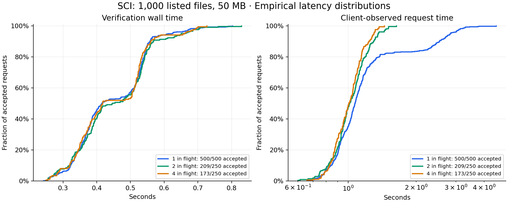

# 1,000-file reliability experiment on Supabase Edge

**Keep the proposed limit of 1,000 listed files and 50 MB, with the separate metadata and parser limits.** This experiment found no verification or platform resource-limit failures. It did find substantial HTTP 429 refusals from the benchmark handler’s one-active-verification-per-worker guard. That guard needs reconsideration before shipping a concurrent submission endpoint.

[Hosted run](https://github.com/azaho/sci/actions/runs/42166947257), measured commit `c07045d`. Four temporary deployments in `us-east-1`, 20 distinct synthetic bundles, 1,000 first attempts, no retries. Each bundle has exactly 1,000 listed files and 50,000,000 listed-content bytes. See the [test protocol](../../README.md) and [verifier coverage](../../../full/COVERAGE.md).

## Outcomes

| Requests in flight | Attempts | Accepted | Busy (429) | Other failures |
| --- | ---: | ---: | ---: | ---: |
| 1 | 500 | 500 | 0 (0.0%) | 0 |
| 2 | 250 | 209 | 41 (16.4%) | 0 |
| 4 | 250 | 173 | 77 (30.8%) | 0 |

All 500 sequential requests succeeded. Busy responses came from our code, before the request downloaded or verified its bundle. They are neither malformed-publication refusals nor Supabase CPU/memory errors. The final workflow assertion deliberately fails if any attempt does not succeed; its failed status preserves this finding.

Supabase can run many workers, and a worker can handle multiple requests. The test observed 636 distinct worker IDs in responses. The local guard refuses an overlapping request routed to the same worker; it is not a project-wide lock. This experiment does not establish maximum platform concurrency or show that a durable queue is required. Compare a revised handler under the same workload before selecting a production concurrency design. [Worker lifecycle](https://supabase.com/kb/troubleshooting/edge-function-cpu-limits), [multiple workers](https://supabase.com/docs/guides/functions/development-tips).

## Latency distribution

Times below cover successful requests only. Verification excludes download. Client time includes HTTP transport, routing, startup, download, and verification. These are wall times, not CPU times.

| Measurement | Median | p95 | p99 | Maximum |
| --- | ---: | ---: | ---: | ---: |
| Verification | 0.418 s | 0.631 s | 0.708 s | 0.830 s |
| Download | 0.309 s | 1.861 s | 2.395 s | 3.895 s |
| Client-observed request | 1.049 s | 2.587 s | 3.152 s | 4.515 s |

| Bundle profile | Accepted / attempts | Verification median | Verification p99 | Maximum |
| --- | ---: | ---: | ---: | ---: |
| ascii | 174 / 200 | 533 ms | 709 ms | 802 ms |
| longpaths | 178 / 200 | 532 ms | 789 ms | 830 ms |
| ordinary | 176 / 200 | 362 ms | 465 ms | 605 ms |
| skewed | 176 / 200 | 327 ms | 423 ms | 478 ms |
| unicode | 178 / 200 | 512 ms | 721 ms | 760 ms |

Each profile has four distinct bundles; each bundle was attempted 50 times. Heavy profiles fill the 1 MiB manifest, 4 MB metadata, and 1 MB README/LICENSE limits. Sixteen of twenty bundles include RFC 3161 proofs. All fixtures passed local verification before deployment. Negative cases remain in the [earlier conformance experiment](../../../full/results/2026-11-06/REPORT.md); this soak uses valid bundles.

## Worker telemetry

The logs contain 640 worker boots and 640 worker shutdowns. Shutdown reasons: {'EarlyDrop': 640}. Of 636 workers identified in measured responses, 636 have a shutdown event. Collection errors: 0.

For 454 workers with exactly one measured successful request, invocation counter 1, and an EarlyDrop shutdown, lifetime CPU ranged from 324 to 1083 ms (median 615 ms). This includes worker startup and work outside the verifier. CPU totals for reused workers cannot be treated as per-request measurements.

Largest sampled heap-used value: 26.14 MB; largest external-allocation sample: 151.83 MB. They can occur at different times and must not be summed as an observed peak. Shutdown memory is also a point sample. No memory-limit failure was observed.

## What this establishes

The data support 1,000 files as a starting admission limit for this verifier under its other size/work caps. They do not establish a universal failure probability. Repeated fixtures, reused workers, one region, one source service, and a short measurement period make these trials dependent. Zero failures in 500 sequential attempts is useful evidence, not a guarantee of zero failures in production. An illustrative independent-trials calculation gives a one-sided 95% upper bound of 0.60%; those independence assumptions do not hold well enough to present that as a production bound.

The function downloads whole ZIPs from temporary private Storage URLs. Arbitrary publisher hosts, regional outages, sustained throughput, live affiliation/revocation lookup, database writes, moderation, and a production TSA trust store remain outside the experiment. The timestamp authority here uses disposable test certificates. The DOI-prefix fix noted after the earlier benchmark is included in this measured commit.

## Evidence and cleanup

[Every request as CSV](requests.csv), [complete statistical summary](summary.json), and the four `wave-*` folders preserve request responses, fixture descriptions, deployment identities, plans, logs, and cleanup receipts. A [later read-only log collection](https://github.com/azaho/sci/actions/runs/42169191169) adds `runtime-logs-final.json` without changing the measurements. It covers all 640 worker shutdowns, including four preflight workers. An initial follow-up hit the log API rate limit; its partial files are retained as `runtime-logs-first-followup.json`. The final collection used four bounded queries and completed with no errors or retries.

All four cleanup receipts report no errors: temporary functions, fixture objects, and private buckets were removed. No existing publication, database table, or production function was changed. The hosted soak workflow is now manual-only to prevent accidental reruns.
