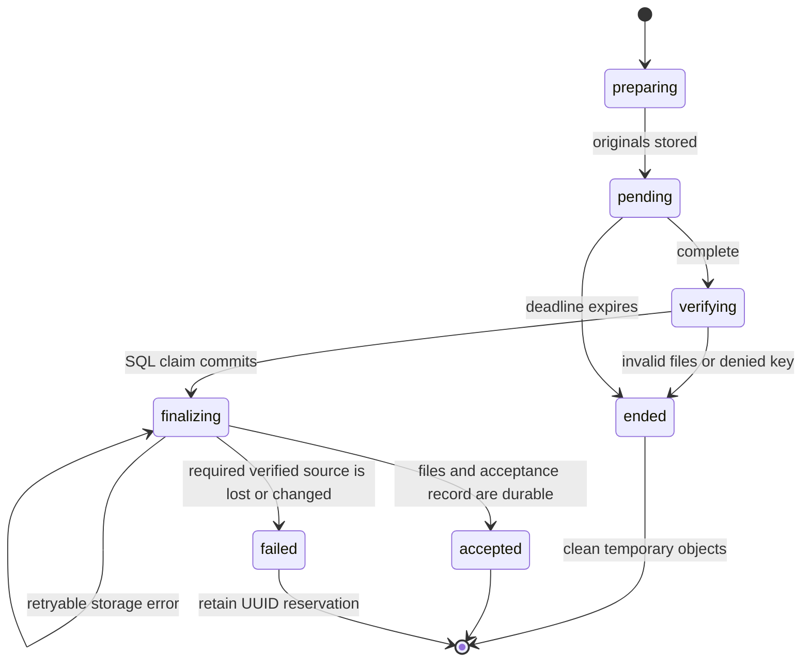

# Implementation choices

The publication contract comes from [DESIGN.md](../DESIGN.md). This document
records the choices needed to implement it.

| Choice | Reason and effect |
| --- | --- |
| Python distribution `sci-publications` | The `sci` name is already in use on PyPI. The command and import name remain `sci`. No package was uploaded to PyPI. |
| Python 3.12 or later | One supported baseline keeps the CLI, server, and tests consistent. |
| FastAPI, psycopg 3, and boto3 | The publisher uses an ASGI service, explicit PostgreSQL transactions, and S3 operations. It imports the same verifier as the CLI. |
| Session advisory lock per UUID | The lock remains held during storage operations and SQL commits. Completion requests and recovery workers cannot finalize the same UUID at the same time. Use a direct connection or session pooler. |
| Transaction advisory lock per author key | Whitelist changes and the final admission check use the same lock. A disable operation cannot cross the admission commit without a defined order. |
| Fifteen-minute upload deadline | Retries retain the original deadline. Upload IDs and storage prefixes are new for each new attempt. |
| PostgreSQL request counters | All publisher workers share the default limit of 120 requests per client address per minute. The service does not trust arbitrary forwarded-address headers. Configure trusted proxies for the host. |
| Repeated cleanup until URL expiry | A presigned PUT URL can be reused. Cleanup checks an ended attempt again until its deadline so a late PUT cannot leave a permanent temporary object. Committed finalizations keep their sources. |
| Frozen Unicode 16.0 Graphic ranges | Python and SQL use the same DOI character set even when their runtime Unicode versions differ. They use the same conformance fixtures. |
| DOI keys decode once and fold ASCII case only | Non-ASCII case and Unicode normalization remain unchanged. A suffix slash must be `%2F`. Literal percent signs must be `%25`. The signed target is never rewritten. |
| SeaweedFS 4.48 for local S3 | The local service has a published image and native binary. Its S3 API passed the conditional-copy and private-bucket checks. It does not establish R2 behavior. Telemetry and unused web interfaces are disabled. |
| nginx for local static files and public reads | It serves the website, adds response headers, and limits catalog requests. Python is not in the catalog or archive read path. |
| Generated static output | The descriptor, category catalog, license copy, and CSP are written to a separate output directory. Shared source files contain no instance credentials or URLs. |
| Pinned browser libraries | Markdown-it 15.0.3 and DOMPurify 3.4.17 are included with license notices. The reader has no CDN dependency or frontend build. |
| Standard PostgREST relationships | Computed relationships support citation/source embedding. Views use caller privileges and RLS. |
| Checked initial migration | The migration runner records the SQL checksum and serializes installation. Later schema changes require a new migration; they must not modify a deployed migration. |
| Encrypted Terraform plan artifact | AES-256-GCM protects the saved plan. The associated data binds it to the repository, commit, and workflow run. The apply job decrypts and applies that same plan after environment review. |
| Separate infrastructure and application releases | The first infrastructure apply can create storage without a publisher. Runtime credentials and migrations are installed before the publisher app is created. Routine code and website releases need no infrastructure apply. |

## Fixed publication assets

Schema version 1 freezes the exact UTF-8 bytes in
`sci/publication_LICENSE.txt`:

- Size: `20921` bytes.
- SHA-256: `221819c0f43f1eb3f86eb5c454092b4ff76856cc93485941cd2ddce2015f2c03`.

The file contains a fixed scope statement and the unmodified CC BY 4.0 and MIT
texts. The MIT template placeholders refer to the signed attribution and
copyright notices. Names and dates are not interpolated into the fixed file.
Changing these bytes requires a protocol revision that retains support for
historical publications.

The bundled category snapshot contains 155 arXiv codes, labels, and groups. It
does not copy the longer category descriptions. Future updates must preserve
historical codes.

## Recovery behavior

The archive can contain incomplete public files during finalization. They are
not accepted until `acceptance.json` is durable. A direct pull can then succeed
before the final catalog visibility update. A catalog rebuild checks every file
and leaves writes disabled. It cannot reconstruct operational SQL state.

## Website

The design follows the supplied `autosci-try0` reference: white background, plain
typography, text rows, muted metadata, blue links, and a narrow information
column. The feed contains no images. The reader shows the headline figure once.
Desktop and mobile screenshots use synthetic demonstration publications from
`examples/create_demo.py`.

Publisher text uses text nodes. README HTML reaches the page only after
Markdown-it and DOMPurify process it. Raw HTML and Markdown images are disabled.
The sanitizer forbids image elements and relative asset links. If a library is
missing, the reader shows the original README as plain text.

## Sources checked

- [DOI URI Scheme](https://doi.org/10.1000/292), published 2024-11-13.
- [arXiv category taxonomy](https://arxiv.org/category_taxonomy), snapshot 2026-10-20.
- [CC BY 4.0 legal text](https://creativecommons.org/licenses/by/4.0/legalcode.txt).
- [SPDX MIT text](https://github.com/spdx/license-list-data/blob/main/text/MIT.txt).
- [Supabase Terraform setup](https://supabase.com/docs/guides/deployment/terraform/tutorial).
- [R2 bucket locks](https://developers.cloudflare.com/r2/buckets/bucket-locks/).
- [PostgREST resource embedding](https://docs.postgrest.org/en/stable/references/api/resource_embedding.html).
- Provider schemas for Cloudflare 5.28.0, DigitalOcean 2.106.0, and Supabase 1.11.0.

## Work reserved for a hosted release

No cloud resources were created for this implementation. Real R2 size enforcement,
cloud credential scopes, hosted headers, hosted catalog rate controls, and a
production backup/restore drill require the configured installation. See
[HOSTED.md](HOSTED.md). These checks are not inferred from local S3 tests.

Unsigned legacy research is not imported. The design requires a signed import
attestation format before that work can start.
